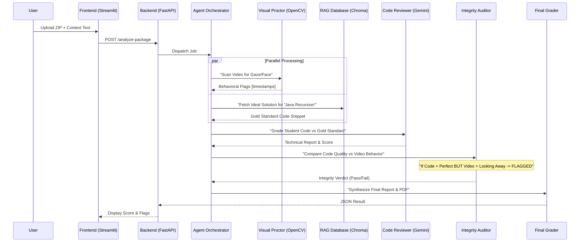

# System Architecture & Workflow

## 1. Why Agents? (vs Single AI)

A single LLM prompt fails at complex, multi-modal tasks. By splitting the work, we achieve higher accuracy:

* **Visual Proctor**: Handles raw video frames (60fps) which is too heavy for an LLM.
* **RAG Manager**: Fetches "Truth" (Ideal Solutions) so the AI doesn't hallucinate.
* **Integrity Auditor**: Cross-references "Perfect Code" with "Suspicious Behavior" (e.g., pasting).

## 2. Component Workflow Diagram

## 3. Data Flow Detail

| Component | Input | Operation | Output |
| :--- | :--- | :--- | :--- |
| **Frontend** | ZIP File + Text Context | Validates file types | Uploads to `/uploads` |
| **Proctor** | Video (.mp4) | OpenCV Face Detection | List of suspicious timestamps |
| **RAG** | Context Text | Vector Search (ChromaDB) | Relevant "Ideal Code" block |
| **Code Reviewer** | Student Code + RAG Context | Static Analysis (Gemini) | Technical Score (0-100) |
| **Integrity** | Video Flags + Tech Score | Logic Correlation | Integrity Status (Certified/Failed) |

## 4. RAG Integration

**"Where is RAG?"**
The RAG system is **internal**. You initialized it once with `init_rag.py`.

* **Link:** When a student submits "Python Factorial", the RAG Manager searches the database for "Python Factorial".
* **Usage:** It retrieves the *correct* recursive implementation and gives it to the Code Reviewer as a cheat-sheet.
* **Benefit:** The AI knows exactly what to look for, rather than guessing.
